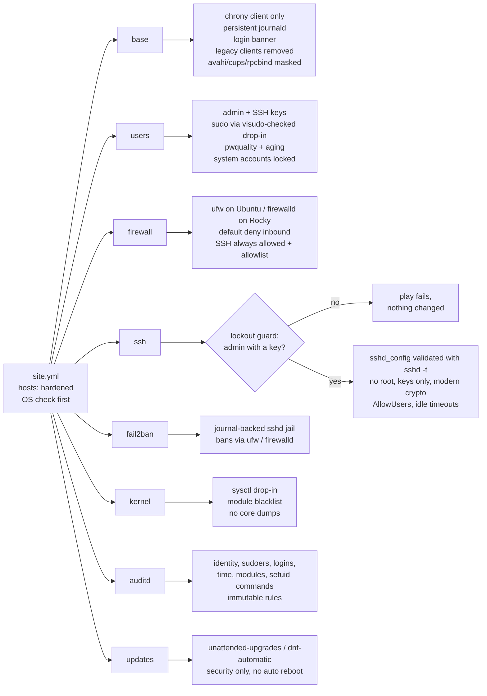
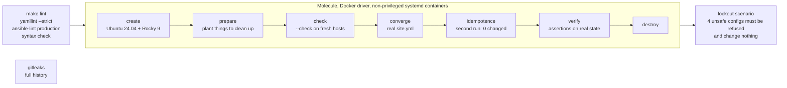

# Ansible Linux Hardening

[](https://github.com/frenzyali/ansible-linux-hardening/actions/workflows/ci.yml)

Eight idempotent Ansible roles that harden Ubuntu 24.04 and Rocky Linux 9 servers (SSH, users, firewall, fail2ban, kernel, auditd, updates, baseline), with input validation, a guard against SSH lockout, and Molecule tests in Docker that run in CI on every push.

## Architecture



Roles run in this order on purpose: **users** (admin and key exist) and **firewall** (SSH allowed) come before **ssh** turns password logins off. Each role validates its own inputs (`meta/argument_specs.yml`), loads per-OS variables (`vars/Debian.yml`, `vars/RedHat.yml`), and can be switched off with `<role>_enabled: false`.

How it is tested:



## Stack

Versions are pinned. They were looked up on PyPI, Ansible Galaxy and Docker Hub on **2026-10-06**.

| Component | Version | Pinned in |
|---|---|---|
| ansible-core | 2.21.5 | `requirements-dev.txt` |
| ansible-lint / yamllint | 26.9.0 / 1.38.0 | `requirements-dev.txt` |
| Molecule / molecule-plugins[docker] | 26.9.0 / 26.9.28 | `requirements-dev.txt` |
| ansible.posix / community.general / community.docker | 2.2.2 / 13.5.0 / 5.4.0 | `requirements.yml` |
| Test images | `ubuntu:noble-20260917`, `rockylinux/rockylinux:9.8.20260525.0` | `molecule/shared/*.Dockerfile.j2` |
| gitleaks | 8.30.1 | CI (checksum-verified), `.pre-commit-config.yaml` |
| GitHub Actions | checkout v7.0.1, setup-python v7.0.0 | `.github/workflows/ci.yml` |

## What it demonstrates

- **Lockout protection that is itself tested.** The ssh role refuses to turn password logins off unless an admin can still log in with a key that is really on the host and allowed by AllowUsers/AllowGroups. A separate Molecule scenario feeds it three unsafe configurations and proves each one fails with `LOCKOUT PROTECTION` and leaves `sshd_config` byte-for-byte unchanged; a fourth case proves `PermitRootLogin yes` is rejected by input validation.
- **Validate before replace.** `sshd_config` goes through `sshd -t`, sudoers through `visudo -cf`, chrony through `chronyd -p`, and fail2ban through `fail2ban-client --test` before anything is reloaded. A broken file never becomes the live one.
- **Idempotent and honest in `--check --diff`.** A second converge must report **0 changed** tasks, and Molecule runs the whole playbook in check mode against fresh hosts first, so the dry run the README tells you to do actually works.
- **Clean role design.** Eight single-purpose roles with tasks split by concern, per-OS vars files, role-prefixed variables, feature toggles, tags per role and per control, FQCN modules, and `meta/argument_specs.yml` so bad input fails before any task runs.
- **Tests check behaviour, not variables.** Verification reads `sshd -T`, logs in with a real SSH client (a key works; password and root logins are refused), scores passwords with `pwscore`, queries the live fail2ban jail, computes the effective sysctl values across every `sysctl.d` file, and checks every setuid binary has an audit rule.
- **Two distributions, one interface.** ufw vs firewalld, unattended-upgrades vs dnf-automatic, `ssh.socket` activation on Ubuntu vs `sshd` on Rocky, `common-password` vs `system-auth`: the differences live in `vars/` and small backend task files.

## Supported platforms

| Platform | Status |
|---|---|
| Ubuntu 24.04 LTS (noble), x86_64 | Tested in Molecule and CI |
| Rocky Linux 9, x86_64 | Tested in Molecule and CI |
| Other EL9 rebuilds (AlmaLinux 9, RHEL 9) | Accepted by the OS check, untested |
| aarch64 | Audit rules adapt (b64 only), untested |
| Anything else | Refused by the OS check in `site.yml` |

Controller: Python 3.12 with the pinned tools above. Managed hosts: the distribution's own Python 3.

## Prerequisites

- Linux or macOS with Python 3.12, `make`, and Docker Engine (cgroup v2) for the tests
- No root on your machine: everything installs into a local `.venv/`

## Quick start

Run the full test suite locally. Molecule only ever targets throwaway containers named `alh-*`.

```bash
git clone https://github.com/frenzyali/ansible-linux-hardening.git
cd ansible-linux-hardening
make venv            # .venv with pinned tools + pinned collections in .ansible/
make lint            # yamllint --strict, ansible-lint (production), syntax check
make test-ubuntu     # Molecule default scenario on Ubuntu 24.04
make test-rocky      # Molecule default scenario on Rocky Linux 9
make test-lockout    # negative test: the lockout guard must refuse unsafe runs
```

`make test` runs every scenario on every platform. A default-scenario run takes about 8 to 10 minutes per distribution (mostly package downloads) and the lockout scenario about 3.

### Using it on real servers

> **Warning:** this changes how you log in. Keep a second SSH session open as root (or an admin with sudo) on every host until you have confirmed that a **new** key-based login works. If something goes wrong, that session is how you undo it.

1. **Create your inventory** (`inventories/production/` is gitignored):

   ```bash
   cp -r inventories/example inventories/production
   cp inventories/production/group_vars/all.yml.example inventories/production/group_vars/all.yml
   ```

   Edit `hosts.yml` (your hosts in the `hardened` group) and `group_vars/all.yml`. At minimum set `users_admins` with **your own public key**: without it the ssh role will refuse to disable password logins, by design.

2. **Dry run first** and read the diff:

   ```bash
   .venv/bin/ansible-playbook -i inventories/production/hosts.yml site.yml --check --diff
   ```

3. **Apply**, one host first:

   ```bash
   .venv/bin/ansible-playbook -i inventories/production/hosts.yml site.yml --limit web-01.example.com
   .venv/bin/ansible-playbook -i inventories/production/hosts.yml site.yml
   ```

4. In a **new** terminal, log in with your key as the admin user and run `sudo -v`. Only then close the old session.

Single roles or controls can be applied with tags, e.g. `--tags ssh`, `--tags kernel_sysctl`, `--tags users_password_policy`.

## Project layout

```text
.
├── site.yml                       # OS check, then the eight roles in order
├── ansible.cfg                    # no default inventory on purpose
├── requirements.yml               # pinned collections
├── requirements-dev.txt           # pinned Python tooling
├── inventories/example/           # placeholder hosts + group_vars/all.yml.example
├── roles/
│   └── <role>/
│       ├── defaults/main.yml      # every user-facing variable, commented
│       ├── vars/                  # Debian.yml, RedHat.yml (OS facts), main.yml (derived)
│       ├── tasks/                 # main.yml imports one file per concern
│       ├── handlers/main.yml
│       ├── templates/
│       ├── meta/main.yml          # platforms
│       ├── meta/argument_specs.yml
│       └── README.md
├── molecule/
│   ├── shared/                    # Ubuntu 24.04 and Rocky 9 systemd test images
│   ├── default/                   # all roles: prepare, converge (site.yml), verify/<role>.yml
│   └── lockout/                   # negative test for the ssh lockout guard
├── Makefile
└── .github/workflows/ci.yml
```

## Role catalogue

| Role | What it does | Key variables | Tags |
|---|---|---|---|
| [base](roles/base/README.md) | Baseline packages, removes telnet/rsh/NIS/tftp/ftp, chrony as a client only, persistent bounded journald, login banner, masks avahi/cups/rpcbind | `base_packages_extra`, `base_chrony_sources`, `base_banner_text`, `base_services_disabled` | `base`, `base_packages`, `base_time`, `base_journald`, `base_banner`, `base_services` |
| [users](roles/users/README.md) | Admins with keys and sudo, sudoers drop-in with `use_pty` and a log, pwquality enforced by PAM, password aging, system accounts locked | `users_admins`, `users_sudo_nopasswd`, `users_pwquality_settings`, `users_login_defs` | `users`, `users_admins`, `users_password_policy`, `users_system_accounts` |
| [firewall](roles/firewall/README.md) | Default-deny inbound with ufw (Ubuntu) or firewalld (Rocky), SSH always allowed, allowlist | `firewall_allowed_ports`, `firewall_ssh_port`, `firewall_ufw_ssh_rule` | `firewall`, `firewall_install`, `firewall_rules` |
| [ssh](roles/ssh/README.md) | Lockout guard, `sshd -t`-validated config, no root/passwords, AllowUsers, modern crypto, MaxAuthTries, idle timeouts | `ssh_password_authentication`, `ssh_allow_users`, `ssh_port`, `ssh_ciphers`, `ssh_kex_algorithms` | `ssh`, `ssh_lockout_guard`, `ssh_config`, `ssh_idle_timeout` |
| [fail2ban](roles/fail2ban/README.md) | Journal-backed sshd jail, incremental bans, bans through the managed firewall | `fail2ban_bantime`, `fail2ban_findtime`, `fail2ban_maxretry`, `fail2ban_ignoreip` | `fail2ban`, `fail2ban_install`, `fail2ban_jails` |
| [kernel](roles/kernel/README.md) | sysctl drop-in (live values on real hosts), module blacklist, no core dumps | `kernel_sysctl_overrides`, `kernel_ip_forwarding`, `kernel_disable_usb_storage` | `kernel`, `kernel_sysctl`, `kernel_modules`, `kernel_coredumps` |
| [auditd](roles/auditd/README.md) | Audit rules for identity, sudoers, logins, time, modules, permission changes, mounts and every setuid/setgid binary; immutable | `auditd_immutable`, `auditd_rules_*`, `auditd_conf` | `auditd`, `auditd_install`, `auditd_config`, `auditd_rules`, `auditd_service` |
| [updates](roles/updates/README.md) | unattended-upgrades or dnf-automatic, security only, no automatic reboot | `updates_security_only`, `updates_automatic_reboot` | `updates`, `updates_install`, `updates_config`, `updates_timers` |

Every role also has `<role>_enabled` and, where something can only run on a real host, `<role>_runtime_apply` (see [Testing](#testing)).

## Controls

These controls are **CIS-inspired**: they follow the intent of the CIS Benchmarks for Ubuntu and RHEL-family systems, but this project does not claim CIS compliance and has not been measured against a benchmark (see [Roadmap](#roadmap)).

| Setting | Role | Risk it reduces |
|---|---|---|
| `PermitRootLogin no` | ssh | Brute force against the one account that exists everywhere; no audit trail of who used root |
| `PasswordAuthentication no`, `KbdInteractiveAuthentication no` | ssh | Password guessing and credential stuffing over SSH |
| `AllowUsers` = the admins | ssh | Service and forgotten accounts being reachable over SSH |
| `MaxAuthTries 3`, `LoginGraceTime 30`, `MaxStartups 10:30:60` | ssh | Fast guessing on one connection; unauthenticated connections tying up the daemon |
| curve25519 / sntrup761 KEX, AEAD/CTR ciphers, ETM SHA-2 MACs | ssh | Downgrade to weak or SHA-1-based algorithms |
| No TCP/agent/X11 forwarding, no tunnels | ssh | Using a server as a pivot into internal networks; agent hijacking |
| `ClientAliveInterval 300` × 2, `TMOUT=900` | ssh | Abandoned sessions left open for someone else to use |
| `LogLevel VERBOSE` | ssh | Not knowing which key was used for a login |
| Default deny inbound + allowlist, SSH rate-limited (ufw) | firewall | Exposed services nobody meant to publish |
| sshd jail, incremental bans | fail2ban | Sustained brute force from the same sources |
| Admin group sudo via `visudo`-checked drop-in, `use_pty`, sudo log | users | Broken sudoers locking out root; untraceable privileged commands |
| pwquality (min 14, 4 classes, dictionary) enforced by PAM | users | Weak local passwords (console, sudo) |
| `PASS_MAX_DAYS 365`, `PASS_MIN_DAYS 1`, `UMASK 027` | users | Indefinitely reused passwords; new files readable by everyone |
| System accounts: `nologin` shell, locked password | users | Interactive logins as service accounts |
| `kernel.kptr_restrict=2`, `dmesg_restrict=1`, `perf_event_paranoid=3` | kernel | Kernel address leaks that help exploit development |
| `randomize_va_space=2`, `yama.ptrace_scope=1` | kernel | Reliable memory exploits; one process reading another's secrets |
| `unprivileged_bpf_disabled=1`, `bpf_jit_harden=2` | kernel | A large class of local privilege-escalation bugs |
| `protected_{hardlinks,symlinks,fifos,regular}`, `suid_dumpable=0`, no core dumps | kernel | Link and FIFO tricks in shared directories; secrets in core files |
| No redirects or source routing, `rp_filter=1`, SYN cookies, no forwarding | kernel | Traffic redirection, spoofing and SYN floods |
| cramfs, freevxfs, jffs2, hfs, hfsplus, dccp, sctp, rds, tipc cannot load | kernel | Rarely used kernel code with a history of exploitable bugs |
| Audit rules for identity, sudoers, logins, time, modules, setuid commands; `-e 2` | auditd | Undetected account, privilege and clock tampering; an attacker silently turning auditing off |
| Security updates installed automatically | updates | Known, already-patched vulnerabilities staying open |
| chrony client only (`port 0`, `cmdport 0`), persistent journal | base | Wrong timestamps across logs; logs lost on reboot; an exposed NTP service |
| telnet/rsh/NIS/tftp/ftp removed, avahi/cups/rpcbind masked, neutral banner | base | Clear-text protocols and needless listening services; OS details given to attackers |

## Design decisions

1. **Flat `roles/` layout instead of a collection.** ansible-lint and Molecule work with it with no extra paths, `site.yml` reads simply, and roles are referenced by short names. *Trade-off:* the roles cannot be installed with `ansible-galaxy collection install` or versioned as one artifact. Packaging them as `frenzyali.hardening` is mostly a move of directories plus a `galaxy.yml` (see Roadmap).
2. **Input validation with `meta/argument_specs.yml`.** Types, required keys and `choices` are checked before any task runs, so `ssh_permit_root_login: yes` or a string where a list belongs fails up front with a clear message. Defaults stay in `defaults/main.yml` (so `ansible-doc -t role -r roles ssh` renders the specs with `default: null`; the commented defaults file is the reference). *Trade-off:* every new variable is declared in two places. Defaults that would need OS facts at validation time were avoided on purpose (they are resolved in `vars/` after validation).
3. **`sshd -t` before replace.** The whole `sshd_config` is templated, and Ansible's `validate:` runs `sshd -t -f` on the candidate file, so a typo can never become the live config. The hardened settings come *before* `Include sshd_config.d/*.conf`, because sshd keeps the first value it reads: a cloud-init `PasswordAuthentication yes` drop-in cannot win. *Trade-off:* owning the whole file means local edits to `sshd_config` are overwritten; changes belong in variables or drop-ins.
4. **The lockout guard checks the host, not just the variables.** A key that only exists in `group_vars` does not count on a real run, because the users role might be disabled or might have failed; the guard reads `authorized_keys` and group membership on the target. It runs before the role installs or writes anything. *Trade-off:* in `--check` mode on a fresh host the users role has not created anything yet, so declared keys are accepted there (clearly a dry run only).
5. **Testing in non-privileged containers, with one explicit switch.** Molecule containers run systemd as PID 1 with `cgroupns_mode: host` and a writable cgroup mount, not `privileged: true`. `hardening_in_container: true` sets each role's `<role>_runtime_apply` to false, which skips **only** the steps that would touch the shared host kernel or need host capabilities: setting live sysctls, loading audit rules, enabling the firewall, starting chronyd. Every configuration file is still written and verified. *Trade-off:* those runtime steps are not exercised by the tests (see [Testing](#testing)). The Ubuntu test container gets one capability, `NET_ADMIN`, because the ufw module reads `ufw status`, which calls iptables; that capability only covers the container's own network namespace.
6. **Security-only updates, no automatic reboots.** Security fixes are what you cannot afford to wait for; feature and bug-fix updates are better rolled out deliberately. Rebooting is left to the operator so a kernel update never takes a service down at an unplanned time. *Trade-off:* kernel and libc fixes are installed but not active until someone reboots, and non-security bugs are not fixed automatically. Both are one variable away.
7. **OS differences in `vars/`, not in `when:` chains.** Each role loads `vars/<os_family>.yml` (package names, service units, file paths) and keeps one task list; only genuinely different mechanisms (ufw vs firewalld, apt vs dnf-automatic) get their own small task file. *Trade-off:* `vars/` has the highest precedence, so those OS facts cannot be overridden from inventory; everything a user should change is in `defaults/`.
8. **Check mode is supported, not assumed.** Tasks that depend on an earlier step (a package that is not installed yet, a user that does not exist yet) are skipped only in check mode, through a per-role `<role>_check_mode_pending` flag, and Molecule runs `--check` on fresh hosts to prove it. *Trade-off:* the first dry run on a new host cannot show diffs for files owned by packages that are not installed yet.
9. **Availability over audit completeness when the disk fills.** auditd suspends logging and reports to syslog instead of halting the machine, which the CIS benchmark prefers. *Trade-off:* an attacker who fills the disk can create a gap in the audit trail. Change `auditd_conf` if a halt is the right answer for your system.
10. **Additive firewall rules.** The role opens what must be open and removes known distribution defaults (cockpit), but does not purge rules it did not create. *Trade-off:* a port opened by hand stays open; pruning unknown rules automatically on a production host is riskier than leaving them.

## Testing

| Check | Command | What it proves |
|---|---|---|
| yamllint | `yamllint --strict .` | Every YAML file (including `*.yml.example`) is valid and consistently formatted |
| ansible-lint | `ansible-lint` (profile `production`, strict, no rules skipped) | FQCNs, naming, idempotence patterns, no bare commands without `changed_when`, valid `meta` and argument specs |
| Syntax check | `ansible-playbook --syntax-check site.yml` | The entry point parses with the example inventory |
| Molecule `check` | `ansible-playbook --check` on fresh containers | The dry run in the instructions works on an unhardened host |
| Molecule `converge` | the real `site.yml` | All eight roles apply cleanly on Ubuntu 24.04 and Rocky 9 |
| Molecule `idempotence` | second converge | **0 changed** tasks: nothing is reported as changed when nothing changed |
| Molecule `verify` | `molecule/default/verify/<role>.yml` | See below |
| Lockout scenario | `molecule test -s lockout` | Three unsafe configs (no key; key only in variables; key present but user blocked by AllowUsers) all fail with `LOCKOUT PROTECTION`, `ssh_permit_root_login: "yes"` fails argument validation, and `sshd_config`, the running sshd and password logins are untouched |
| gitleaks | `gitleaks git` (full history) | No secrets were ever committed |

What `verify` checks, per role:

- **ssh:** `sshd -T` (effective config) shows root login, passwords and keyboard-interactive off, MaxAuthTries 3, the timeouts, AllowUsers, the banner and the exact cipher/MAC/KEX lists with no CBC or SHA-1. A real client then logs in with a key (works), with a password (refused) and as root (refused).
- **users:** admin exists in `admins`, the configured key is present and a planted stray key is gone, `sudo -l` shows the rule and `use_pty`, `visudo -c` passes, `pwscore` rejects a short password and accepts a long one, PAM has `pam_pwquality`, login.defs is set, a planted system account with `/bin/bash` now has `nologin` and a locked password, root is untouched.
- **firewall:** ufw default policies and saved rules (`ufw show added`); firewalld default zone, target, services (ssh, no cockpit) and ports via `firewall-offline-cmd`.
- **fail2ban:** `fail2ban-client --test`, then the live jail reports maxretry 5, findtime 600, bantime 3600 and the right ban action.
- **kernel:** effective boot-time sysctl values computed from `systemd-analyze cat-config sysctl.d` (last file wins, so no later file overrides ours), `modprobe --showconfig` blocks each module, core dumps disabled.
- **auditd:** expected rules present, `-e 2` present, and every setuid binary found independently with `find` has a rule.
- **updates:** `apt-config dump` shows only security origins (the packaged list really was cleared), or dnf-automatic is security-only; timers enabled and active.
- **base:** chrony installed and client-only, telnet removed and rpcbind masked (both planted by `prepare`), journal persistent, banner present without OS details.

**What container tests cannot prove.** The test containers share the host's kernel, so these are configured and checked as files but not exercised:

- Live sysctl values (`/proc/sys` is read-only; applying them would change the host).
- Loaded audit rules and auditd itself (the kernel audit subsystem is not available in a container), including the `-e 2` lock and `augenrules --load`.
- Firewall enforcement: ufw is not enabled and firewalld is not running, so no packet is actually filtered, and fail2ban never performs a real ban.
- Kernel module blocking at load time, chronyd actually adjusting the clock, and behaviour across a reboot.
- SELinux/AppArmor interaction (containers run without the host's policy for the target).

Those parts need a VM-based test (see Roadmap) or a careful first run on a disposable server.

## Known limitations

- **No VM-level tests.** See the list above: the runtime half of kernel, auditd and firewall is exercised only on real hosts.
- **x86_64 only in tests.** aarch64 should work (audit rules switch to b64-only syscall names) but has not been run.
- **SELinux and AppArmor are not managed.** On Rocky with SELinux enforcing, a non-default `ssh_port` also needs `semanage port` (not automated).
- **Firewall rules are added, not pruned.** Rules created by hand stay in place; firewall source restrictions (allow SSH only from given networks) are not implemented yet.
- **Password aging applies to new accounts.** Existing users keep their aging until changed with `chage`.
- **Immutable audit rules need a reboot to change.** The role writes the new rules and tells you; it does not reboot.
- **No CIS score.** The controls are CIS-inspired and the mapping above is my own; no benchmark scanner has been run against the result.
- **Root password is not locked.** Root SSH login is off, but console access with the root password is kept as a recovery path.

## Roadmap

- **SELinux / AppArmor role:** enforce mode, required booleans, and `semanage port` for a custom SSH port.
- **CIS scanning with OpenSCAP:** run the SCAP Security Guide profiles for Ubuntu 24.04 and RHEL 9 in CI against a VM, and publish the report to measure (not claim) the coverage.
- **Debian 12 support:** mostly a `vars/Debian.yml` check and a new Molecule platform.
- **VM-based scenario** (Vagrant or a cloud runner) to exercise live sysctls, loaded audit rules, real firewall enforcement and a reboot.
- **Firewall source allowlists** for SSH (with a guard that the controller stays inside them).
- **Package as the `frenzyali.hardening` collection** on Ansible Galaxy.

## Cleanup

```bash
make clean        # molecule destroy for every scenario, then removes .venv/ and .ansible/
```

Only Molecule instances of this repository are removed: containers named `alh-*` (`alh-ubuntu2404`, `alh-rocky9`, `alh-lockout-ubuntu2404`, `alh-lockout-rocky9`), on the default bridge network (no networks are created). Check with:

```bash
docker ps -a --filter name=alh-
docker image ls 'molecule_local/alh-*'     # test images; remove with docker image rm if you like
```

## Related work

- [observability-stack](https://github.com/frenzyali/observability-stack): Prometheus, Alertmanager and Grafana as code, with unit-tested alert rules and an end-to-end alert test in CI.
- [aws-terraform-3tier](https://github.com/frenzyali/aws-terraform-3tier): a 3-tier AWS environment in modular Terraform (VPC, ALB, Auto Scaling, RDS), validated and scanned in CI.

## License

[MIT](LICENSE) © 2026 Syed Ali Hussain
